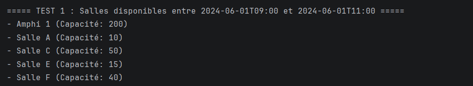
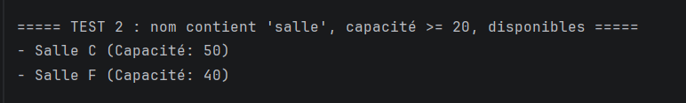
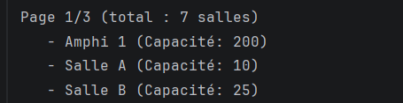
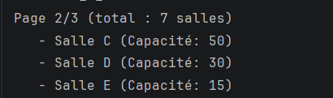
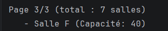

# 🏢 Salle Management — Résultats d'exécution

## Image 1 — Salles disponibles (JPQL)

La requête JPQL affiche les salles libres entre 9h et 11h le 01/06/2024. Salle B et Salle D sont exclues car leurs réservations chevauchent ce créneau.

## Image 2 — Recherche multi-critères (Criteria API)

La recherche combine trois filtres : nom contenant « salle », capacité ≥ 20 et disponibilité sur le créneau. Seules Salle C et Salle F respectent les trois conditions.

## Image 3 — Pagination, page 1/3

Les 7 salles sont réparties en pages de 3 éléments, soit 3 pages au total. Cette première page affiche les éléments 1 à 3.

## Image 4 — Pagination, page 2/3

La deuxième page saute les 3 premières salles grâce à `setFirstResult(3)`. Elle affiche les éléments 4 à 6.

## Image 5 — Pagination, page 3/3

La dernière page ne contient qu'une seule salle, ce qui est normal pour un total de 7 éléments. Le découpage final est donc 3 + 3 + 1.